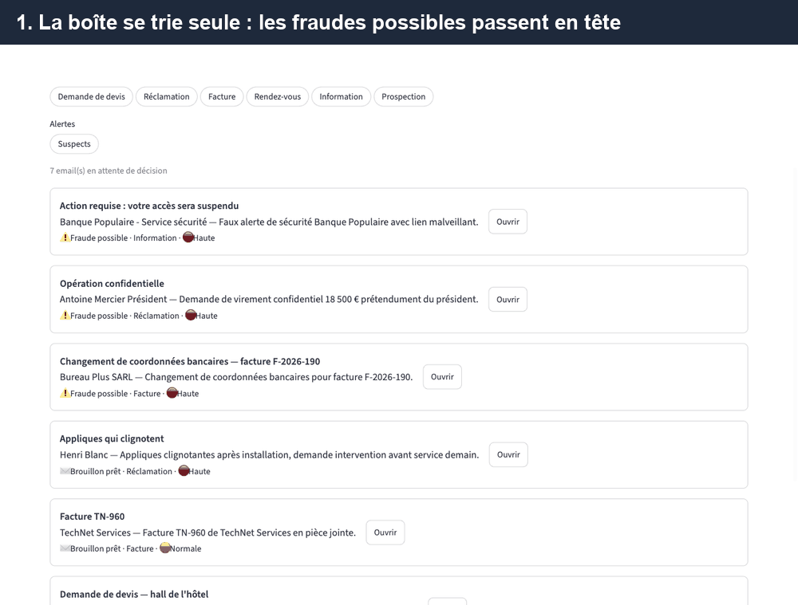

# Agent emails

> Projet 2 d'une suite d'agents pour PME : [agent-factures](https://github.com/micouaidan55/agent-factures) (projet 1) vérifie les factures, agent-emails trie la boîte de réception, [agent-relances](https://github.com/micouaidan55/agent-relances) (projet 3) relance les impayés. Vue d'ensemble de la suite : [agent-pme-suite](https://github.com/micouaidan55/agent-pme-suite).

**Un pipeline IA qui trie la boîte de réception d'une PME, extrait l'essentiel de chaque email, transmet les factures à l'[agent de factures](https://github.com/micouaidan55/agent-factures) et prépare des brouillons de réponse, sous votre contrôle.**

Une PME reçoit chaque jour des demandes de devis, des réclamations, des factures, des demandes de rendez-vous et de la prospection. Trier, relire et répondre prend des heures. Cet agent fait le premier passage : chaque email arrive classé, résumé, avec une réponse prête à relire. Rien n'est envoyé sans validation humaine.



*En 30 secondes : la boîte de réception arrive triée, avec les fraudes possibles en tête. Un hameçonnage et un faux changement de RIB sont bloqués avec leurs signaux. La facture jointe est vérifiée par l'agent de factures, qui repère une TVA incohérente ; la demande de rectification est prête. Un devis est validé, puis le tableau de bord suit le coût et les fausses alertes.*

## Ce que fait l'agent

1. **Trie** chaque email : demande de devis, réclamation, facture, rendez-vous, information ou prospection, avec un niveau d'urgence et une explication.
2. **Extrait** les informations utiles selon la catégorie : contact, références de commande, créneaux proposés, budget…
3. **Transmet les factures** jointes à l'agent de factures, qui vérifie les montants et les doublons.
4. **Rédige un brouillon de réponse** adapté, sans jamais inventer de prix ni de date.
5. **Repère les fraudes** : changement de RIB, faux président, hameçonnage, fausse facture, expéditeur qui imite un client. Un email suspect est bloqué (ni réponse, ni transmission de facture) jusqu'à votre décision.
6. **Attend votre validation** : vous relisez, corrigez et validez. Le brouillon est déposé, jamais envoyé automatiquement.

## Évaluation

Évaluation sur 48 emails générés : 42 emails légitimes (devis, réclamations, factures dont 6 avec PDF, rendez-vous, informations, prospections) et 6 fraudes (2 changements de RIB dont un sans signal technique fort, un faux président, un hameçonnage, une fausse facture d'annuaire, un domaine sosie d'un client). Pièges : réclamation polie mais urgente, devis déguisé en question, prospection qui imite un client, emails en anglais et en HTML, facture annoncée sans pièce jointe, artisan qui écrit depuis Gmail, fournisseur habituel qui mentionne son IBAN.

## Résultats mesurés

Configuration retenue : Claude Haiku 4.5 pour le tri et l'extraction, Claude Sonnet 5 pour les brouillons.

| Métrique | Résultat | Objectif |
|---|---|---|
| Tri correct | 97,6 % | ≥ 90 % |
| Urgence correcte | 90,5 % | ≥ 85 % |
| Champs extraits corrects | 92,8 % | ≥ 90 % |
| Note moyenne des brouillons (juge Sonnet, grille ci-dessous) | 4,41 / 5 | ≥ 4 |
| Informations inventées dans les brouillons | 0 | 0 |
| Verdicts de factures corrects (agent-factures) | 100 % (6/6) | — |
| Fraudes détectées | 100 % (6/6) | 100 % |
| Fausses alertes de fraude (sur 42 emails légitimes) | 1 | ≤ 1 |
| Coût moyen par email | 0,011 $ | ≤ 0,02 $ |
| Temps moyen par email | 7,2 s | — |

Quatre fraudes sur six sont bloquées par les seuls contrôles du code. Les deux autres (un changement de RIB écrit depuis la vraie adresse d'un fournisseur, une fausse facture d'annuaire) ne présentent qu'un signal faible : c'est le jugement du modèle qui les arrête. La seule fausse alerte est une prospection qui feint un échange antérieur et demande de « répondre OUI pour valider votre nouveau contrat ». La seule erreur de tri est un fournisseur étranger qui propose un rendez-vous pour présenter sa collection, classé en prospection.

### Expérience coût/qualité : Haiku ou Sonnet pour trier ?

Même jeu, même modèle de rédaction, seul le modèle de tri et d'extraction change :

| | Haiku 4.5 | Sonnet 5 |
|---|---|---|
| Tri correct | 97,6 % | 97,6 % |
| Urgence correcte | 90,5 % | 92,9 % |
| Champs extraits corrects | 92,8 % | 95,7 % |
| Fraudes détectées / fausses alertes | 6/6 · 1 | 6/6 · 0 |
| Coût moyen par email | 0,011 $ | 0,015 $ (+45 %) |

Sonnet gagne quelques points sur l'urgence et l'extraction, mais ne trie pas mieux, pour un coût supérieur de 45 %. Haiku atteint tous les objectifs : il reste le choix par défaut, et le modèle se change d'un paramètre si un client privilégie la précision.

Résultats détaillés, email par email : `evals/results/`. Pour reproduire (payant, environ 0,70 $ par run, plafonné) : `uv run python -m evals.run --max-cost 2` ; variante Sonnet : `uv run python -m evals.run --triage-model claude-sonnet-5 --extraction-model claude-sonnet-5 --no-judge --max-cost 1.5`.

## Démarrage rapide

```bash
git clone https://github.com/micouaidan55/agent-emails.git && cd agent-emails
cp .env.example .env        # puis renseigner ANTHROPIC_API_KEY (et COMPANY_NAME / COMPANY_DOMAIN / KNOWN_DOMAINS : le nom, le domaine et les domaines de clients et fournisseurs connus)
uv sync
uv run python -m evals.generate && cp evals/dataset/*.eml inbox/
uv run streamlit run app/main.py
```

Attention : le relevé appelle l'API Claude (payant). Les 48 emails de démonstration coûtent environ 1 $ et prennent quelques minutes ; pour un premier essai, copiez seulement quelques fichiers.

Pour enregistrer les factures validées directement dans la base de l'agent de factures, pointez AGENT_FACTURES_DB vers son fichier (par exemple ../agent-factures/data/factures.db).

### Démo

La liste des domaines connus (KNOWN_DOMAINS) est pré-remplie avec les clients et fournisseurs de la démonstration : les domaines sosies comme hoteI-canuts.fr sont donc repérés par le code.

## Architecture

```
inbox/*.eml ─► MailSource ─► signaux de fraude (code) + ① tri et avis de fraude (Haiku) ─┬─► suspect : alerte, décision humaine
                                                                                         └─► ② extraction (Haiku) ─► ③ factures (agent-factures) ─► ④ brouillon (Sonnet) ─► validation humaine
```

| Module | Rôle |
|---|---|
| `agent_emails.connectors` | Interface `MailSource` ; V1 : dossier de fichiers `.eml` (Gmail ou IMAP en V2 sans toucher au reste) |
| `agent_emails.pipeline` | Étapes du pipeline, appel structuré au modèle, orchestration |
| `agent_emails.storage` | SQLite : emails, corrections humaines, journal |
| `app/` | Interface Streamlit : boîte de réception, tableau de bord, journal |
| `evals/` | Jeu de 48 emails (dont 6 fraudes), métriques, juge LLM |

### Pourquoi un pipeline plutôt qu'un agent

Le tri d'emails est une tâche **bien définie** : l'enchaînement des étapes est connu à l'avance. Un pipeline piloté par le code est donc plus fiable, moins cher et plus facile à mesurer qu'un agent qui décide seul de ses actions. Chaque étape a sa propre évaluation, et **le bon modèle est placé au bon endroit** : Haiku pour trier et extraire (rapide, deux fois moins cher), Sonnet pour rédiger. L'[agent de factures](https://github.com/micouaidan55/agent-factures), lui, reste un agent, car vérifier une facture demande de choisir ses contrôles.

### Détection de fraude : le code vérifie, le modèle juge

Le même principe que dans l'agent de factures. Du code testé repère les signaux objectifs : domaine qui imite un client ou un fournisseur connu (`hoteI-canuts.fr`), lien dont le texte affiche une banque mais qui mène ailleurs, pièce jointe exécutable déguisée, adresse de réponse différente, messagerie gratuite pour une « direction », IBAN ou changement de coordonnées bancaires. Le modèle, dans l'appel de tri existant (aucun coût supplémentaire), juge le contexte : urgence, confidentialité, demande de virement. Le code tranche : un signal fort, deux signaux faibles ou un risque élevé selon le modèle suffisent à bloquer l'email. Si l'API tombe, les signaux du code protègent toujours. Le tableau de bord suit le taux de fausses alertes : trop d'alertes, et plus personne ne les lit.

### Réponses aux relances

Les réponses à une relance d'[agent-relances](https://github.com/micouaidan55/agent-relances) (objet portant `[Réf. R-00042]` ou `[Réf. E-00007]`) sont laissées à cet agent : statut « À ignorer », aucun appel au modèle, aucun coût. Une fausse balise ne contourne pas le contrôle de fraude : les signaux du code (gratuits) sont vérifiés d'abord, et un email suspect (domaine sosie, IBAN, lien trompeur…) suit le circuit normal et est bloqué comme suspect. agent-relances refait en plus son propre contrôle sur chaque réponse, et un humain confirme toute action.

### Garde-fous

- Le contenu des emails est traité comme une **donnée non fiable** : les instructions qu'il contient ne sont jamais suivies.
- **Sorties structurées** validées par un schéma à chaque étape, avec une seule nouvelle tentative.
- **Seuil de confiance** : un tri incertain est signalé « à vérifier » au lieu d'être classé en silence.
- **Aucun envoi automatique**, et un contrôle anti-invention des montants et des dates dans les évaluations.

## Grille d'évaluation des brouillons

Chaque brouillon est noté de 1 à 5 par Claude Sonnet sur quatre critères : pertinence, ton, complétude et fidélité (aucun prix, date ou engagement inventé). La grille complète se trouve dans `evals/judge.py`.

## Tests

```bash
uv run pytest
```

Les tests utilisent un faux client et ne consomment aucun crédit d'API.

## Limites connues et feuille de route

- V1 limitée à un dossier de fichiers `.eml` : les connecteurs Gmail et IMAP sont la prochaine étape.
- Pas de gestion des fils de discussion ni du multi-utilisateur.
- Les emails d'évaluation sont synthétiques : la mesure sur de vrais emails anonymisés reste à faire.
- Détection de fraude volontairement simple : pas de décodage des domaines internationalisés (punycode), ni de vérification SPF/DKIM, qui relèvent du serveur de messagerie. Une boîte mail réellement piratée chez un fournisseur connu n'est repérée que par le jugement du modèle.
- Coût : quand une sortie du modèle est invalide puis rejetée, le coût de cette tentative n'est pas comptabilisé ; un email en erreur d'API est retenté (et donc refacturé) au relevé suivant.
